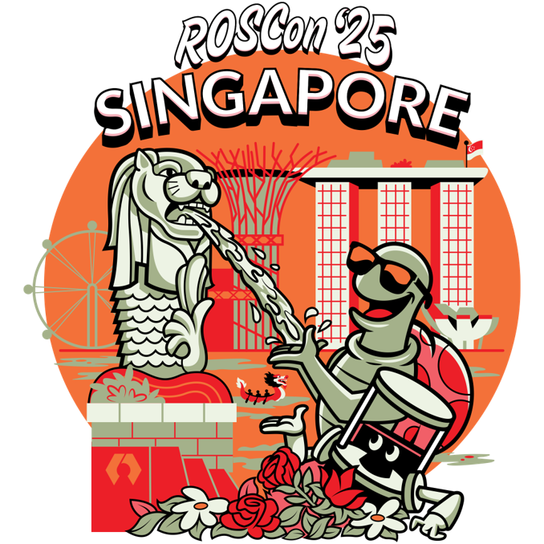
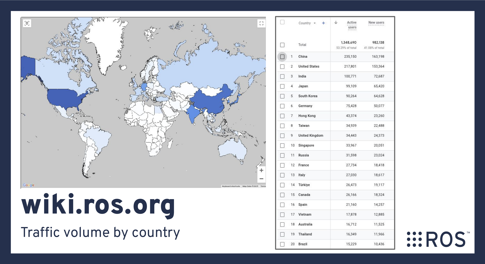

# ROS Community

# Open Source Ecosystem
---

# Agenda

- Open Source Robotics Alliance (OSRA)
- ROS Community / Governance
- ROSCon and Regional ROSCons (ROSCon JP)
- Sponsorship / Participation
- ROS Japan User Group
- ROS Japan Developer Kaigi
- Open Source Ecosystem: What's in it for us?

<!---
Comment here
--->

---

# History of ROS

| Year | Milestone |
| :--- | :--- |
| 2012 | **Open Source Robotics Foundation (OSRF)** incorporated; first **ROSCon** (St. Paul, USA) |
| 2017 | OSRF + OSRC become **Open Robotics**; first ROS 2 release **Ardent Apalone** |
| 2020 | ROS 1 final release, **Noetic Ninjemys** |
| 2022 | **Intrinsic** (Alphabet) acquires OSRC, not OSRF, not ROS |
| 2024 | **OSRA** launched to govern ROS, Gazebo, Open-RMF and Infrastructure |
| 2025 | ROS 1 Noetic reaches End of Life |
| 2026 | **Lyrical Luth** released, LTS until May 2031 |

<!---
Key point for executives: the project has survived three ownership changes (Willow Garage -> OSRF -> Open Robotics / Intrinsic -> OSRA) because it is a community asset, not a company asset.
Sources: openrobotics.org "A Decade of Open Robotics", Intrinsic acquisition blog (Dec 2022), OSRA announcement (Mar 2024).
--->

---

## ROS 1 to ROS 2: Why the Rewrite?

- ROS 1 was built for a single research robot in a lab network.
- Industry needed what ROS 1 could not give:
  - Real-time capable, embedded and microcontroller support
  - Security (authentication, encryption, access control)
  - Multi-robot, lossy and multi-platform networking
  - Standards-based middleware (DDS), pluggable RMW
  - Production quality: lifecycle nodes, QoS, Windows / macOS / RHEL
- ROS 2 is designed **with** industry, which is exactly why industry needs to keep participating.

<!---
See https://design.ros2.org/articles/why_ros2.html
--->

---

## ROS Today in Numbers

From the [2025 ROS Metrics Report](https://discourse.openrobotics.org/t/2025-ros-metrics-report/52575):

- **~984 million** package downloads in 2025, **+85%** over 2024
- **1.3 million** unique IPs downloading packages in October 2025, up from 0.84 million one year earlier
- **91%** of downloads are ROS 2
- ROSCon 2025 Singapore: **950+ attendees, 51+ countries, 354+ companies**

ROS is the de facto common language of robotics software.

<!---
Numbers are proxies; Open Robotics does not track individuals. July 2025 server data was lost, so the annual total is conservative.
--->

---

## Active ROS 2 Distributions

| Distribution | Release | End of Life | Note |
| :--- | :--- | :--- | :--- |
| Rolling Ridley | Continuous | N.A | Development mainline |
| Lyrical Luth | May 2026 | May 2031 | Latest **LTS** |
| Kilted Kaiju | May 2025 | Nov 2026 | Non-LTS |
| Jazzy Jalisco | May 2024 | May 2029 | LTS |
| Humble Hawksbill | May 2022 | May 2027 | LTS |

- New release every year on **World Turtle Day (May 23)**, LTS every two years.
- A five-year LTS only happens because someone funds and maintains the build farm, backports and security fixes.

<!---
See https://docs.ros.org/en/rolling/Releases.html for the authoritative table.
--->

---

# Open Source Robotics Alliance

- An initiative of the **OSRF**, announced 18 March 2024, operating since 15 April 2024
- OSRF assigned governance of its projects to OSRA: **ROS, Gazebo, Open-RMF, Infrastructure, ros-controls**
- **Mixed membership + meritocratic** model, following Linux Foundation / Eclipse / Apache style foundations
- Goal: *long-term stability and health* of the projects, funded by members, governed with the community

<!---
Before OSRA, decisions were de facto made by Open Robotics staff and the ROS 2 TSC. OSRA formalizes who decides, how members get a voice, and how funding flows.
--->

---

# ROS Community / Governance

- **Meritocracy**: influence comes from sustained contribution, not from the size of your company.
- **Committers** are nominated and mentored, then accepted by the PMC.
- **PMC Members** vote on project matters; by default every committer is a PMC member.
- **Project Leader** is nominated by the PMC and accepted by the TGC, re-elected yearly.
- Big changes go through **enhancement proposals** (REPs / design docs) and public review.
- Minutes of formal decisions are published.

<!---
Contrast with a vendor-controlled project: here your engineers can become committers and PMC members. That is the path to influence.
See https://docs.ros.org/en/rolling/The-ROS2-Project/Governance.html
--->

---

## Where the Community Lives

- [GitHub ros2](https://github.com/ros2): source, issues, pull requests, design
- [Open Robotics Discourse](https://discourse.openrobotics.org/): announcements, releases, discussions, **local user groups**
- [Robotics Stack Exchange](https://robotics.stackexchange.com/): Q&A
- [Open Robotics Zulip](https://openrobotics.zulipchat.com/): real-time chat, working groups, Japan channel
- [ROS Index](https://index.ros.org/) and [docs.ros.org](https://docs.ros.org/): packages and documentation
- Working Groups and SIGs: Client Libraries, rosgraph, Release, Security, Interoperability, Embedded, Navigation, Control, ...

<!---
Comment here
--->

---

# ROSCon

| Year | City | Year | City |
| :--- | :--- | :--- | :--- |
| 2012 | St. Paul, USA | 2019 | Macau |
| 2013 | Stuttgart, Germany | 2020 / 2021 | ROS World (online) |
| 2014 | Chicago, USA | 2022 | **Kyoto, Japan** |
| 2015 | Hamburg, Germany | 2023 | New Orleans, USA |
| 2016 | Seoul, Korea | 2024 | Odense, Denmark |
| 2017 | Vancouver, Canada | 2025 | Singapore |
| 2018 | Madrid, Spain | 2026 | Toronto, Canada |

<!---
Source: https://roscon.ros.org/ archive. 2020 and 2021 were held virtually as ROS World due to COVID-19.
--->

---

## ROSCon 2025 Singapore

- 950+ attendees, 51+ countries
- 354+ companies, 66+ universities
- **56 sponsors**, 10 sponsored mini-workshops
- 464 workshop attendees, 8 BoF sessions

## ROSCon 2026 Toronto

- 22 – 24 September 2026, Sheraton Centre Toronto

<!---
I serve on the ROSCon committees (Executive / Program / Session Chair). Happy to walk anyone through how proposals are reviewed.
--->

---

## Regional ROSCons: Local Language, Local Network

| 2026 Event | When | Where |
| :--- | :--- | :--- |
| ROSCon FR | 22 – 25 June | Paris, France |
| **ROSCon JP** | **4 – 5 August** | **Tsukuba, Japan** |
| ROSCon China | 16 – 17 October | Shanghai, China |
| ROSCon UK | 21 – 23 October | Edinburgh, UK |
| ROSCon SG | 26 October | Singapore |
| ROSCon BE | 25 – 26 November | Nivelles, Belgium |
| ROSCon Türkiye | 3 – 4 December | Istanbul, Türkiye |

<!---
Source: Open Robotics Discourse announcements and roscon.ros.org regional pages, checked Nov 2026.
--->

---

## [ROSCon JP](https://roscon.jp/)

| Year | Venue | Year | Venue |
| :--- | :--- | :--- | :--- |
| 2018 | Tokyo (1st) | 2023 | Tokyo |
| 2019 | Tokyo | 2024 | Tokyo |
| 2021 | Online | 2025 | Nagoya (Port Messe) |
| 2022 | Kyoto | 2026 | Tsukuba, **2 days** |

<!---
Verify the early venue list against roscon.jp before presenting. 2020 was skipped due to COVID-19.
--->

---

# Sponsorship / Participation

1. **Attend** ROSCon JP / ROSCon, send your engineers
2. **Speak**: submit a talk or lightning talk about what you built
3. **Sponsor** ROSCon JP or ROSCon
4. **Join OSRA** as Supporting Organization, Silver or higher
5. **Contribute** code, docs, issues, reviews upstream
6. **Host** a ROS Japan UG meetup at your office
7. **Let your engineers join** Developer Kaigi and working groups on company time

<!---
Comment here
--->

---

# [ROS Japan User Group](https://rosjp.connpass.com/)

- Volunteer-run community for ROS users in Japan, since **2016**
- **3,390 members** on connpass, **73 events** held (Nov 2026)
- Study sessions, lightning talk nights, hackathons, in-person meetups (Tokyo, Osaka, ...)
- Recent: #64 3D Gaussian Splatting (Sep 2026), #63 LT night (Jul 2026), #62 Vibe Coding hackathon (May 2026)
- Organizes **ROSCon JP**
- Home on Discourse: [Local User Groups / Japan](https://discourse.openrobotics.org/c/local/japan/32)

<!---
Membership and event counts from rosjp.connpass.com as of Nov 2026.
--->

---

<!---
Japan is consistently in the top countries for ROS documentation traffic. We have the users; we need more developers upstream.
--->

---

# [ROS Japan Developer Kaigi](https://github.com/fujitatomoya/ros-japan-developer-kaigi)

ROS本線を開発しよう 🤖 技術課題をシェアしよう 🧑‍💻 目指せ！ROSコミッター＆メンテナー 🚀

- Japanese-language, **online, bi-weekly, 50 minutes**, no recording
- Scope: **ROS 2 core repositories** (rclcpp, rclpy, rcl, rmw, ros2cli, rosbag2, docs, ...)
- First meeting: **16 September 2025**
- In-person edition at University of Tsukuba, **3 August 2026**, the day before ROSCon JP

<!---
GoogleGroup QR code on the right. Currently hosted under my personal account; the plan is to hand it to the community / organization when ready.
--->

---

# Open Source Ecosystem: What's in It for Us?

- **Shared, non-differentiating infrastructure**: middleware, build tools, drivers, navigation, control, simulation
- Hundreds of companies split the cost of what none of them sells
- Each company differentiates **above** the shared layer: the application, the hardware, the integration
- The shared layer only stays healthy if enough of the beneficiaries give back time or money

<!---
Comment here
--->

---

## Concrete Returns for a Company

- **Lower cost**: fixes upstream once, instead of a private fork
- **Lower risk**: LTS schedule, security policy and EOL
- **Interoperability**: sensors, arms, bases and tools from hundreds of vendors already speak ROS 2
- **Talent**: engineers, ROS skills are portable, so hiring is easier
- **Influence**: a committer or a member vote shapes the roadmap toward your use cases
- **Reputation**: customers and partners see you as a contributor, which matters in procurement and partnerships

<!---
Comment here
--->

---

# Summary

- ROS has outlived three stewards because it belongs to its community; **OSRA** now gives that community formal governance and funding.
- **ROSCon** and regional **ROSCon JP** are where the roadmap, the people and the hiring happen.
- Japan is one of the biggest ROS user bases, with very little presence upstream. **ROS Japan UG** and **ROS Japan Developer Kaigi** are the on-ramps.
- Participation and sponsorship are inexpensive compared with the cost of passively depending on a project you do not influence.

**Let's build ROS, not only build on ROS.** 🚀

<!---
Comment here
--->

---

# References

- [ROS 2 Documentation](https://docs.ros.org/) / [Governance](https://docs.ros.org/en/rolling/The-ROS2-Project/Governance.html) / [Releases](https://docs.ros.org/en/rolling/Releases.html)
- [Open Source Robotics Alliance](https://osralliance.org/) / [Membership](https://osralliance.org/membership/) / [Policies and Procedures](https://github.com/osrf/osra-policies-and-procedures)
- [Announcing the OSRA (Mar 2024)](https://discourse.openrobotics.org/t/announcing-the-open-source-robotics-alliance/48653)
- [2025 ROS Metrics Report](https://discourse.openrobotics.org/t/2025-ros-metrics-report/52575)
- [ROSCon](https://roscon.ros.org/) / [ROSCon JP](https://roscon.jp/)
- [ROS Japan User Group (connpass)](https://rosjp.connpass.com/) / [Discourse Japan](https://discourse.openrobotics.org/c/local/japan/32)
- [ROS Japan Developer Kaigi](https://github.com/fujitatomoya/ros-japan-developer-kaigi)
- [Why ROS 2?](https://design.ros2.org/articles/why_ros2.html) / [A Decade of Open Robotics](https://www.openrobotics.org/blog/2022/3/22/a-decade-of-open-robotics)

<!---
Comment here
--->
